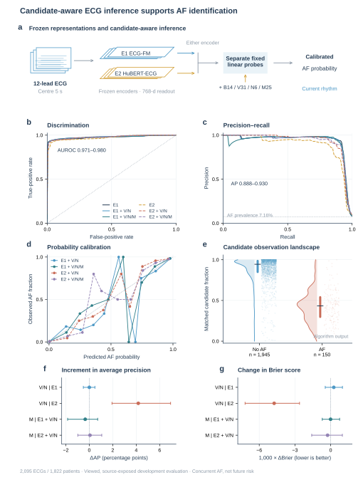

# StrokeBridge · 脑心桥

### Evidence-aware ECG analysis for brain–heart research

StrokeBridge connects ECG representation research with an auditable route toward brain–heart screening. Its central design is simple: **a predictive signal is not automatically a reliable biological measurement, and a concurrent diagnosis is not a future-risk estimate.**

The repository combines reproducible ECG evidence, heartbeat-resolved measurement audits, a transparent method-development history and an aggregate-only research interface. It does not provide individual clinical predictions.

The heart and brain are attributed educational anatomical illustrations, not patient images or clinical validation. The architecture and evidence gates are editable vectors; this anatomy-containing figure is a hybrid vector/raster composition. See [asset attribution](assets/ATTRIBUTION.txt).

## What is new here?

1. **Separate what the model uses.** The AF research workflow distinguishes demographic/RR information, candidate visibility/count/confidence, candidate morphology and frozen ECG representations instead of treating every increase in discrimination as evidence of atrial biology.
2. **Make a P-wave measurement accountable.** BRIDGE-P—*beat-resolved identity and detection-gated endpoint audit*—checks same-heartbeat identity, one-to-one candidate use, local endpoint error and patient-level coverage separately. Rejected or missing measurements are not relabelled as biological absence of P.
3. **Test reachability before more training.** Cache-based decoder factorials and necessary-condition bounds distinguish failures that ranking can fix from failures under frozen candidate support and calibration rules. A scientifically uninformative training proposal can stop before fitting.
4. **Preserve the evidence chain.** Source hashes, aggregate tables, software tests and clearly named experimental versions make positive findings, negative findings and engineering corrections inspectable together.

These are research workflow and measurement-audit contributions. This repository does not claim a new general coverage theorem, a clinically validated P-wave detector, an accepted Nature paper, or a validated stroke-prediction system.

## Explore the project

| Component | What it does | Status |
| --- | --- | --- |
| **AF-ID** | Historical concurrent AF identification: baseline features, candidate information and frozen ECG encoders | Research evidence; not future AF or stroke prediction |
| **P-MeasureAudit / BRIDGE-P** | Heartbeat identity, unique candidates, uncertainty and reporting reliability | Implemented, tested audit contracts; practical measurement gates remain unmet |
| **Brain–Heart Risk** | Time-ordered clinical + ECG + brain-side evidence and incident outcomes | **Planned only**; no clinical risk output |
| **Research interface** | Inspect audited aggregate results and synthetic schema checks | Offline HTML available; Streamlit source supplied |

## Start in two minutes

The core tools use only Python 3.10+ standard libraries. No model weights or clinical files are required.

```bash
# From the repository root
PYTHONPATH=src python -m unittest discover -s tests -v
PYTHONPATH=src python -m strokebridge summary
PYTHONPATH=src python -m strokebridge synthetic-contract
PYTHONPATH=src python -m strokebridge example
```

PowerShell:

```powershell
$env:PYTHONPATH = (Join-Path (Get-Location) 'src')
python -m unittest discover -s tests -v
python -m strokebridge summary
```

Open the downloaded `demo.html` in a browser for the offline interactive evidence viewer. The GitHub file view displays HTML source; it is **not** a hosted clinical application. No uploads, individual prediction, model training or network calls are enabled by the viewer.

To test the actual viewer JavaScript without a browser:

```bash
node tests/test_demo_switches.mjs
```

The mock-DOM test checks 96 phase/policy/seed/lead/stage configurations and 1,152 table cells against the packaged aggregates. It does not claim browser-render or Streamlit runtime validation.

### Optional Streamlit research viewer

Use a separate environment; do not change an existing research environment:

```bash
python -m venv .venv
.venv/bin/python -m pip install -r requirements.txt
.venv/bin/python -m streamlit run streamlit_app.py --server.address 127.0.0.1
```

On Windows, use `.venv\Scripts\python.exe`. `requirements.txt` pins the direct UI dependency, not a fully resolved environment lock. A real cloud-demo URL is added only after a successful deployment. See [deployment boundaries](docs/DEPLOYMENT.md).

## Evidence snapshot and validation scope

This is a completed research closeout, **not a clinical-performance release**:

- **A32:** patient-complete multibeat supervision was evaluated with paired comparators: 20 fits, 160 epochs. Benefits were inconsistent across the two seeds. Under W1, both arms and seeds rejected all final measurements. Patient joint coverage was 0/176; precision was undefined, not zero.
- **A33:** a zero-fit decoder factorial audit replayed 20 caches. Better candidate reachability did not establish useful reporting coverage, and no new decoder policy was promoted.
- **A34:** endpoint-only training was **not admitted** and used 0 fits. A frozen-support/calibration necessary condition bounded one seed's optimistic patient coverage at 79.55%, below the 95% target. This bound is not measured model performance; the other seed's 100% optimistic bound is not a 100% result.

The two seeds evaluate the same 200 patients, not two independent cohorts. The joint-coverage positive denominator is 176 patients and spans all reference P waves in leads II and V1. Partial-reference precision is not a clinical no-P validation. Stable morphology-only AF gains, independent unseen-data generalization and clinical future-risk prediction remain unestablished.

The full validation trail is retained in [Supplementary Figure 7: A32](supporting_figures/SupplementaryFigure7_A32_patient_supervision_and_reliability.svg), [Supplementary Figure 8: A33](supporting_figures/SupplementaryFigure8_A33_decoder_mechanism_and_ceilings.svg) and [Supplementary Figure 9: A34](supporting_figures/SupplementaryFigure9_A34_admission_and_clinical_translation.svg). The real public waveform mechanism example is [Supplementary Figure 3](supporting_figures/SupplementaryFigure3_real_waveform_failure.svg); it is a selected calibration illustration, not an unbiased performance sample.

SPH remains quarantined. RDB was not scored as an independent V1/no-P reference. Hospital and expert-reference branches remain pending; no new hospital records are included here.

## Publication figures and source data

Four main figures contain 25 panels (6 + 7 + 6 + 6). All four editable-text SVGs and all nine supporting SVGs are available here. The local publication handoff also contains vector PDF, high-resolution PNG and grouped editable PPTX masters; only successfully uploaded binary attachments are linked below. Exact and display curve coordinates are separated; reported metrics are not computed from smoothed display curves. The [main legends](figures/MAIN_FIGURE_LEGENDS.txt) and [supporting legends](supporting_figures/LEGENDS.txt) define each panel's measured, schematic or diagnostic-bound status.



- [Figure 1: Framework](figures/Figure1_StrokeBridge_framework.pdf)
- [Figure 2: AF inference and observation — editable SVG](figures/Figure2_AF_inference_and_observation.svg)
- [Figure 3: Structured measurement and missingness](figures/Figure3_structured_measurement_and_missingness.pdf)
- [Figure 4: Information validity and patient evidence — editable SVG](figures/Figure4_information_validity_and_patient_evidence.svg)
- [Aggregate source-data tables](source_data/) and [figure release verification](figures/FIGURE_RELEASE_VERIFICATION.json)

These figures visualize the current research findings and planned validation logic. They do not imply a patient-facing clinical service or a validated future-stroke model.

## Repository map

```text
src/strokebridge/                 Safe standard-library evidence and audit tools
tests/                           Synthetic contracts, archive/aggregate and interface checks
data/audited_aggregate_results.json  Aggregate A32/A33 results and A34 bounds; no patient rows
demo.html                        Offline aggregate-only interactive viewer
streamlit_app.py                 Optional Streamlit viewer; no clinical inference
archive/phase_*/code/             99 historical source files for inspection, not direct execution
ARCHIVE_MANIFEST.json             Original/exported source hashes and path-redaction status
provenance/                      Source/result lineage
docs/                            Version history, inputs, libraries and deployment
figures/                         Publication-oriented figures when included in the release
NOTICE.md                        Rights and third-party boundaries; no invented MIT licence
```

### Historical code is not an active training entry point

The local frozen originals were preserved. For publication, 22 of 99 archival files had machine-specific absolute-path prefixes/account labels redacted; their original and exported hashes are recorded separately. They are not described as byte-identical where changed. Old training/recovery scripts have expired run windows and cross-stage dependencies. **Do not execute historical launchers or infer a new training budget from this repository.**

The supported entry point is `python -m strokebridge`. `verify-sources --workspace PATH` is only for an authorized original workspace; a standalone clone deliberately does not contain the old datasets, checkpoints or original absolute paths.

## Functions and libraries

- `maximum_matching`: augmenting-path maximum-cardinality matching; reference-informed oracle graphs are diagnostics, not test-time selectors.
- `patient_joint_coverage`: distinct legal candidates for every reference P, not interval-union reuse.
- `residual_or_detection_failure`: cross-heartbeat or missing candidates are detection/identity failures, not large local endpoint errors.
- `strict_quantile`: preserve finite-sample order statistics and infinite scores; no automatic post-selection coverage claim.
- `brain_heart_contract.validate`: check baseline information availability, missingness and dated event/death/censoring semantics. A schema pass does not admit a source or authorize fitting.

Core: Python standard library. Optional UI: Streamlit. Historical research used PyTorch, NumPy/SciPy, scikit-learn/joblib, WFDB/h5py and figure-generation tools; those are not needed to browse the released aggregates. See [inputs and library roles](docs/INPUTS_AND_LIBRARIES.md).

For PTB-XL, “official 500-Hz release” is distinguished from the acquisition frequency: the original acquisition was 400 Hz and the release was upsampled to 500 Hz. Historical protocol names are archival labels, not proof of device-native 500-Hz acquisition.

## Responsible use

Concurrent AF identification, independent P/no-P measurement, atrial biology, brain injury and future AF/stroke are different endpoints requiring different references. Unknown outcomes are not negative events; technical rejection is not biological no-P; a high AUROC is not evidence of calibrated future risk.

No raw ECG files, hospital documents, patient-level output tables, model weights, credentials or identity maps are distributed. This code is for research and reproducibility inspection, not diagnosis, treatment or triage.

## 中文简介

脑心桥围绕可验证的心房信息，连接当下AF识别、同心搏测量、患者级可靠性审计与脑心风险研究。当前版本提供可复现的技术实现、信息价值比较和训练前可达性准入检查；完整保留开发轨迹、验证结果及停止规则。未来脑心风险分支仍需同患者脑/心/临床资料与带日期的事件、死亡和删失证据，当前不输出个人卒中风险。

## Rights and citation

See [NOTICE.md](NOTICE.md). No third-party data/model rights are transferred, and no MIT or other permissive licence is assigned without author/institution approval. Formal author metadata, institutional rights and any publication DOI must be verified before adding a final citation. The working release identifier is **StrokeBridge research closeout, 2026-10-25**.

